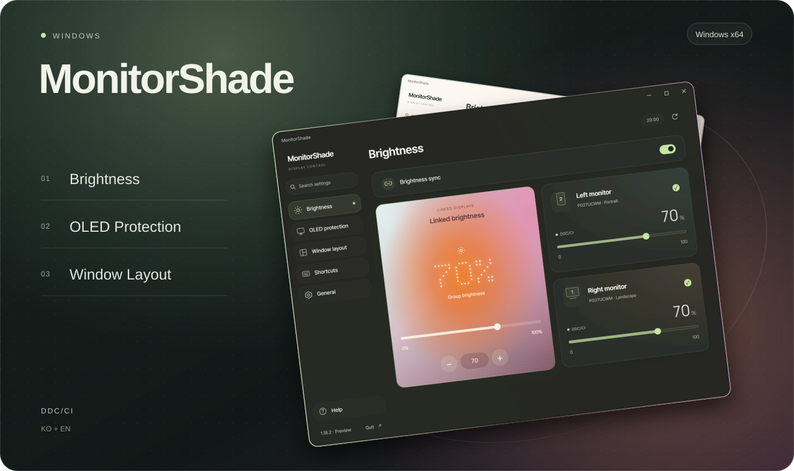
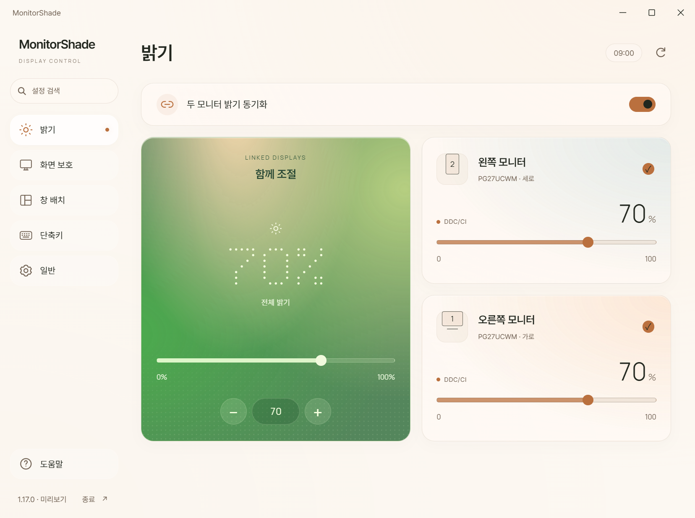
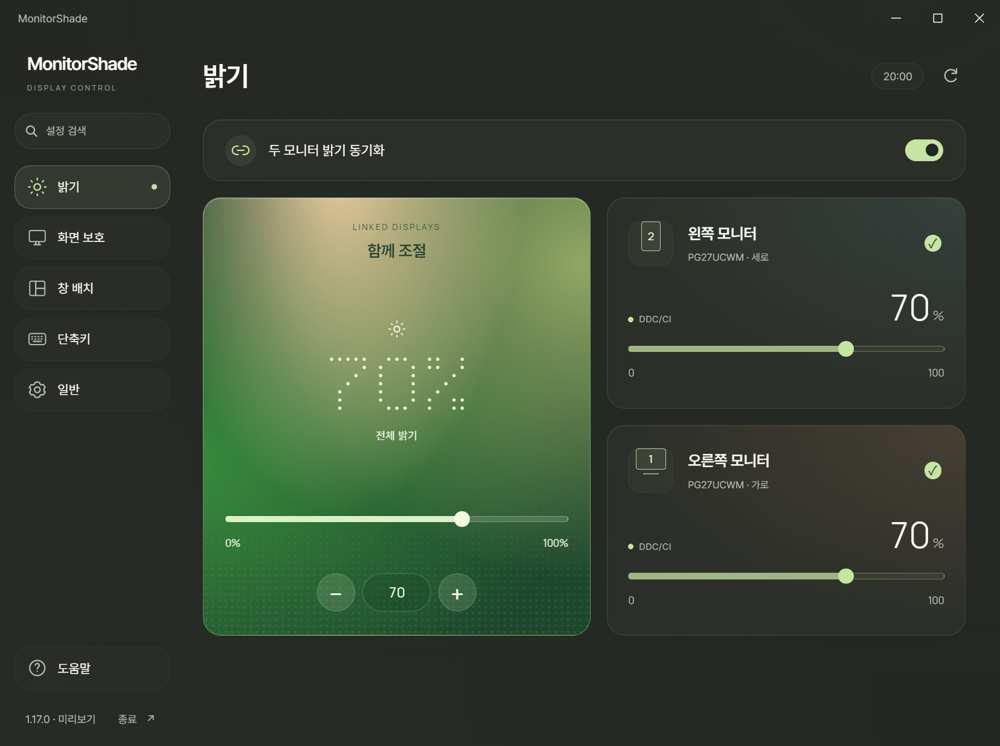

<div align="center">



**화면을 쉬게 하고, 밝기를 맞추고, 창을 정돈하세요.**

Windows용 멀티 모니터 유틸리티 · OLED 화면 보호 · DDC/CI · 창 배치


[시작하기](#시작하기) · [단축키](#손끝에서-정리되는-작업-공간) · [빌드](#직접-빌드하기) · [기술 가이드](docs/technical-guide.md)

</div>

---

## 하나의 콘솔, 여러 화면



<table>
<tr>
<td width="33%"><strong>☀ 밝기를 함께</strong><br><br>모니터마다 따로, 또는 같은 값으로.<br>40 · 60에서 +5 → <strong>65 · 65</strong>.<br>슬라이더와 단축키 모두 지원합니다.</td>
<td width="33%"><strong>◐ 쉬는 화면만 검게</strong><br><br>변화 없는 화면에만 검은 오버레이.<br>마우스가 들어오면 바로 복귀.<br>Lively 배경 제외와 재연결 복구까지.</td>
<td width="33%"><strong>▣ 창을 원하는 곳으로</strong><br><br>방향 배치, 중앙 16:9, 비율 확대.<br>가로·세로 모니터에 맞춰 순환.<br>설정 창도 가장자리를 잡아 조절하세요.</td>
</tr>
</table>

### 아침부터 밤까지, 부드럽게

아침의 흰색·살구빛에서 낮의 세이지, 저녁의 올리브, 밤의 슬레이트로 이어집니다. Windows의 실시간 Acrylic 블러 위에 반투명 카드를 겹치고, 밝기 조절에는 초록빛 앰비언트 카드와 도트 숫자를 사용합니다.

- **찾기 쉬운 설정** — 검색에 `Backspace`, `프리텐다드`, `자동 실행`을 입력해 바로 이동합니다. `Ctrl + F`로 검색을 엽니다.
- **작은 움직임** — 슬라이더의 은은한 호버 광채, 메뉴 반응, 페이지 페이드. 호버만으로 실제 밝기가 바뀌지 않습니다.
- **또렷한 글꼴** — Chromium에서 내장 Pretendard와 Manrope를 렌더링합니다. 도트 숫자는 DPI에 맞춰 확대되는 SVG입니다.
- **가벼운 실행 흐름** — 기본 실행은 트레이에서 시작합니다. 설정 화면은 열 때 초기화하고 숨기면 렌더러를 일시정지합니다.

<details>
<summary><strong>저녁 테마 보기</strong></summary>



</details>

> 화면 예시는 앱의 미리보기 모드로 촬영했습니다. 모니터와 밝기 값은 테스트 데이터이며, 웹 캡처의 배경에는 고정 색상을 사용했습니다. 실제 창 뒤 블러는 바탕화면과 Windows 투명도 설정에 따라 달라집니다.

## 손끝에서 정리되는 작업 공간

| 단축키 | 동작 |
| :--- | :--- |
| **Win + Backspace** | 현재 모니터 비율로 **50% → 70% → 100%** 순환 |
| **Win + ↑ ↓ ← →** | 해당 방향으로 **½ → ⅔ → 최대화** |
| **Win + Delete** | **중앙 16:9 → 최대화** · 기본 너비 65%, 변경 가능 |
| **오른쪽 Alt + F2 / F3** | 밝기 낮추기 / 높이기 · 키와 간격 변경 가능 |
| **Ctrl + Alt + F9 / F10** | 지정한 모니터의 강제 검은 화면 켜기 / 끄기 |
| **Ctrl + Alt + F11** | 설정 열기 |
| **Ctrl + Alt + F12** | 자동 화면 보호 일시정지 / 재시작 |

`Win + Backspace`의 비율은 **작업 표시줄을 제외한 작업 영역의 가로·세로 각각**에 적용됩니다. 50%·70%는 중앙 정렬, 100%는 최대화입니다. 반복하면 다시 50%로 돌아갑니다. 창을 직접 이동·변경하거나 다른 배치 단축키를 사용하면 순환을 처음부터 시작합니다.

<details>
<summary><strong>창 배치 화면 보기</strong></summary>


</details>

## 시작하기

1. `MonitorShade.exe`를 쓰기 가능한 폴더에 둡니다. 공개된 빌드는 [GitHub Releases](https://github.com/iismn/MonitorShade/releases)에서 확인할 수 있습니다. **소스 버전과 공개 릴리즈 버전은 다를 수 있습니다.**
2. 실행 후 트레이 아이콘을 두 번 클릭하거나 `Ctrl + Alt + F11`로 설정을 엽니다.
3. **화면 보호**에서 모니터와 대기 시간(초/분)을 선택하고 **감시 시작**을 누릅니다.
4. **일반 → 로그인 시 자동 실행**을 켜면 다음 로그인부터 창 없이 시작합니다.

**필요 환경:** Windows 10 2004 이상 / Windows 11, x64, .NET Framework 4.8, [Microsoft Edge WebView2 Runtime](https://developer.microsoft.com/microsoft-edge/webview2/). 창 뒤 Acrylic은 **Windows 11 22H2 이상 + 투명도 효과 켜짐**에서 지원됩니다. 미지원 환경에는 단색 배경을 사용합니다.

설정은 EXE 옆의 `MonitorShade.settings.xml`에 저장합니다. 업데이트할 때는 트레이의 **종료**로 앱을 닫고 EXE만 교체하세요. XML을 유지하면 기존 설정을 이어서 사용합니다. 자동 실행을 등록한 뒤 EXE 경로를 바꿨다면 다시 등록하세요.

## 직접 빌드하기

별도 IDE 없이 Windows의 .NET Framework 컴파일러로 빌드할 수 있습니다.

```powershell
powershell -NoProfile -ExecutionPolicy Bypass -File .\source\build.ps1
```

루트에 `MonitorShade.exe`가 생성됩니다. 첫 빌드에서는 고정 버전의 WebView2 SDK를 공식 NuGet에서 받아 SHA-256을 검증합니다. HTML·CSS·JavaScript·글꼴·SDK는 EXE에 포함됩니다. 시스템의 WebView2 Runtime은 별도로 필요합니다.

```powershell
# 기존 로직 + Chromium UI 검사
powershell -NoProfile -ExecutionPolicy Bypass -File .\test.ps1 -IncludeUi

# 실제 모니터 밝기·사용자 설정을 건드리지 않는 UI 미리보기
.\MonitorShade.exe --design-preview
```

화면 보호·재연결·밝기 동기화·키 필터·설정 저장·창 배치·검색·도트 숫자와 UI 연결을 자동 검사합니다. 실제 케이블 재연결이나 모든 모니터의 DDC/CI 호환성을 자동 검사가 보장하지는 않습니다. 자세한 진단 명령은 [기술 가이드](docs/technical-guide.md#검증)에 있습니다.

## 알아둘 점

- 화면 보호는 **검은 오버레이**입니다. 모니터 전원이나 입력 신호를 끄지 않습니다.
- DDC/CI 쓰기는 표준 밝기 명령 `0x10`에 한정합니다. 모니터 OSD에서 DDC/CI를 켜야 하며, HDR·일부 화면 모드에서는 밝기 조절이 제한될 수 있습니다.
- 화면 비교는 메모리에서 처리합니다. 화면 내용을 저장하거나 전송하지 않습니다. 화면 공유에는 검은 오버레이 뒤 내용이 보일 수 있습니다.
- 관리자 권한 앱이나 최소 크기가 제한된 창에는 창 배치를 적용하지 못할 수 있습니다. 기능을 끄면 Windows 기본 단축키 동작으로 돌아갑니다.
- 설정 창을 여는 동안 자동 감시를 일시정지합니다. 닫기 버튼은 트레이로 숨기고, **감시 시작**으로 감시를 이어갑니다.

---

<div align="center">

**MonitorShade** · 개인 작업 공간을 위한 디스플레이 도구

[기술 가이드](docs/technical-guide.md) · [글꼴 출처 및 라이선스](source/fonts/README.md) · [WebView2 고지](source/licenses) · [문제 보고](https://github.com/iismn/MonitorShade/issues)

</div>
