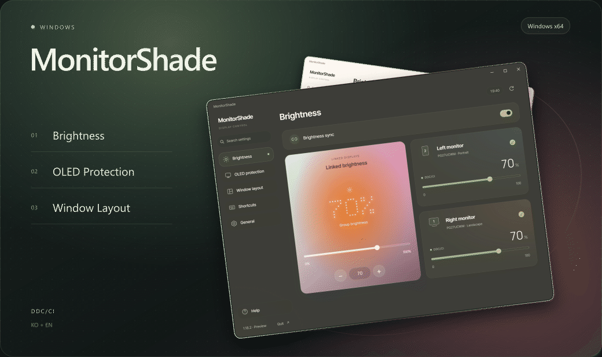
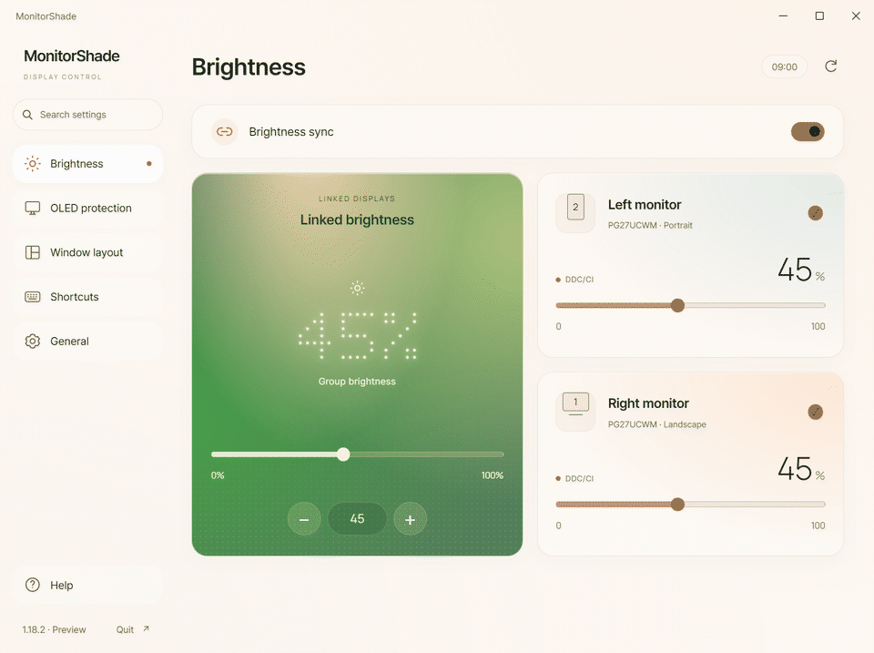
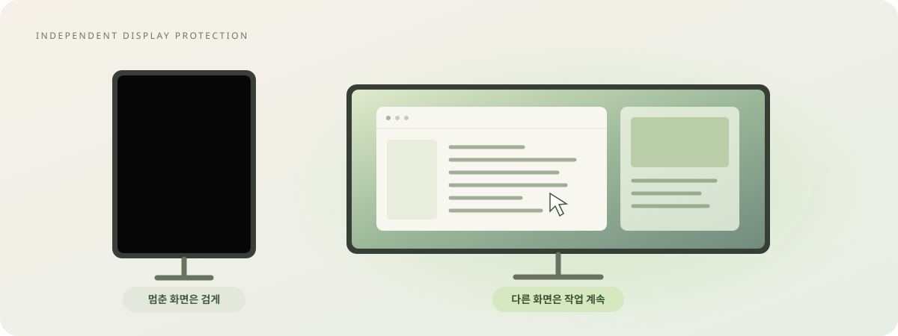
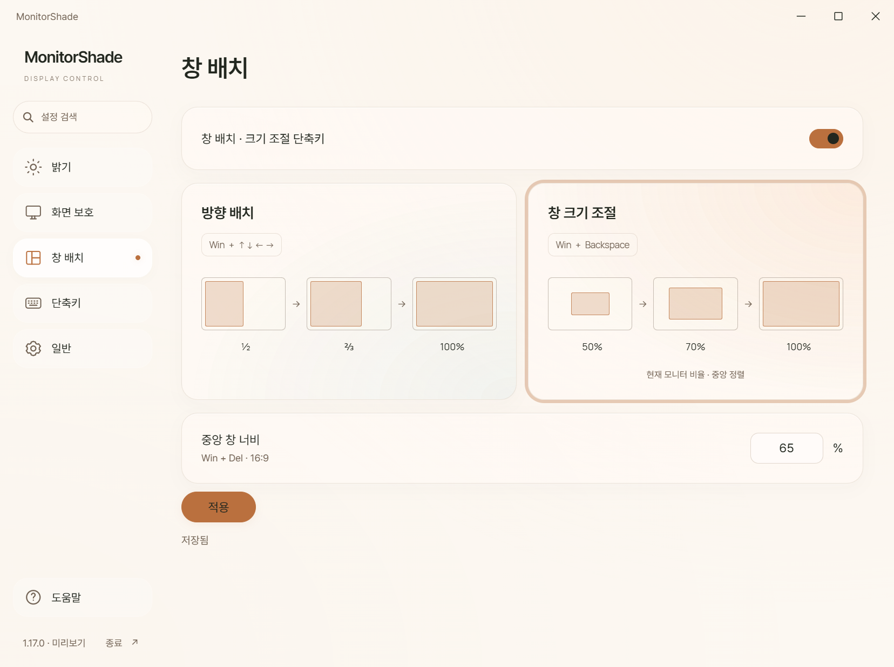
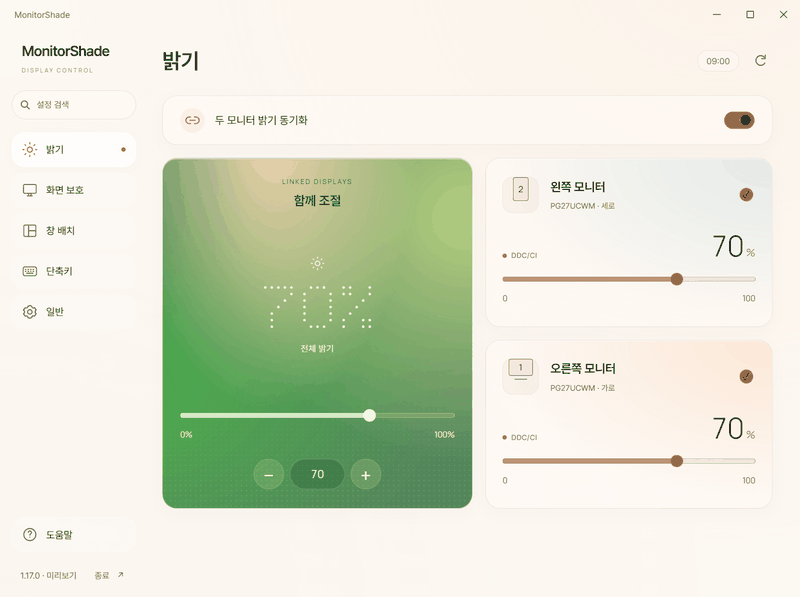
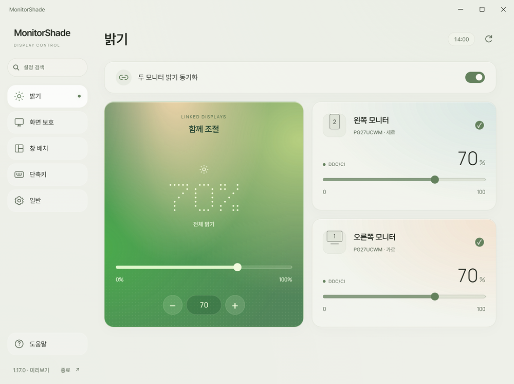
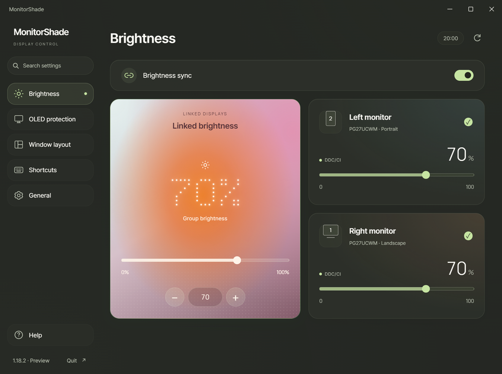
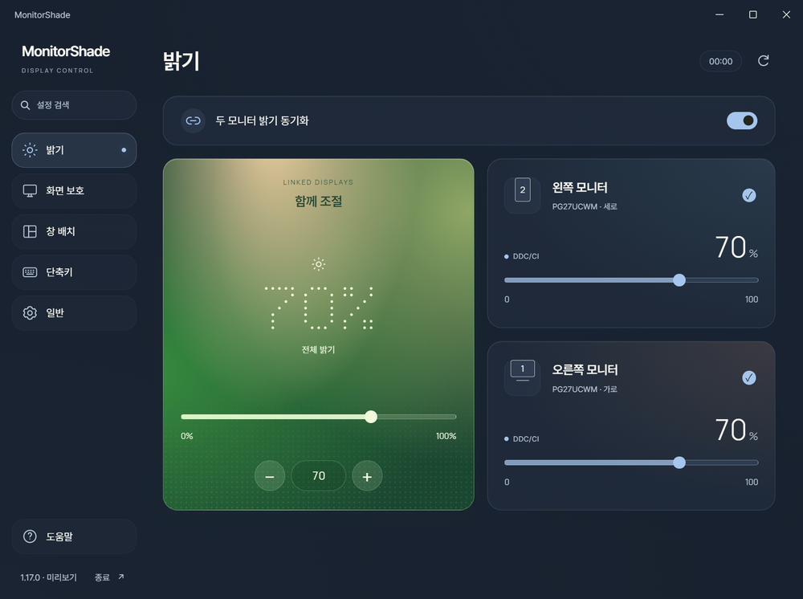

[Windows](https://github.com/iismn/MonitorShade/tree/window) · [macOS](https://github.com/iismn/MonitorShade/tree/mac)

  

**1.18.5 · Windows 10 / 11 · x64**

[Release notes](https://github.com/iismn/MonitorShade/releases/tag/v1.18.5) · [User guide](docs/user-guide.md) · [Issues](https://github.com/iismn/MonitorShade/issues)

[Brightness](#brightness) · [OLED Protection](#oled-protection) · [Window Layout](#window-layout)

 

## Brightness

Recorded in the app with demo monitors.

 

## OLED Protection

Per-monitor black overlay. Restores on mouse entry or screen changes. Supports animated wallpaper exclusion.

Automatic monitoring starts with the app and continues while settings are open. Use the toggle in **OLED Protection** to turn it off. Monitor selection and wait time save automatically.

 

## Window Layout

| Default shortcut | Cycle |
| --- | --- |
| **Win + Backspace** | Centered 50% → 70% → maximized |
| **Win + Arrow** | Directional ½ → ⅔ → maximized |
| **Win + Delete** | Centered 16:9 → maximized |

Percentages apply to work-area width and height. The 16:9 window width is configurable.

Change each binding in **Shortcuts → Window layout and resizing**. Select modifiers and a key, then click **Save**.

 

## Appearance

Choose **KO** or **EN** in **General → Language**.

| 09:00 | 14:00 |
| :---: | :---: |
|  |  |
| **20:00** | **00:00** |
|  |  |

 

<strong>Requirements and setup</strong>

Windows 10 2004+ or Windows 11, x64, and .NET Framework 4.8.

WebView2 is included with Windows 11 and already installed on most Windows 10 PCs. Run the EXE first. [Install WebView2](https://developer.microsoft.com/microsoft-edge/webview2/) only if the app reports that it is missing. [Microsoft deployment details](https://learn.microsoft.com/microsoft-edge/webview2/concepts/distribution).

- Brightness control requires DDC/CI support.
- Desktop blur requires Windows 11 22H2+ with transparency effects enabled.

1. [Download MonitorShade.exe](https://github.com/iismn/MonitorShade/releases/download/v1.18.5/MonitorShade.exe) to a writable folder.
2. Run the EXE. It starts in the system tray.
3. Press **Ctrl + Alt + F11** to open settings.
4. Select monitors and a timeout. **Automatic monitoring** is on by default.

Hover over the sidebar to show menu labels. Click the magnifier or press **Ctrl + F** to search settings. Press **Esc** to close search.

Settings are stored beside the EXE in `MonitorShade.settings.xml`. To update, exit from the tray, replace the EXE, and keep the settings file.

<strong>Limitations</strong>

- The black overlay does not turn off the monitor. Screen sharing may show the content behind it.
- HDR and some monitor modes can restrict DDC/CI brightness control.
- Protected video, exclusive fullscreen apps, and secure desktops can restrict change detection.
- Elevated apps and windows with minimum-size constraints may not accept the requested layout.

 

---

[Download 1.18.5](https://github.com/iismn/MonitorShade/releases/download/v1.18.5/MonitorShade.exe) · [User guide (Korean)](docs/user-guide.md) · [Build guide (Korean)](docs/technical-guide.md) · [Report an issue](https://github.com/iismn/MonitorShade/issues)

[Fonts](source/fonts/README.md) · [WebView2 notices](source/licenses) · [Demo recording source](docs/tools/README.md)
