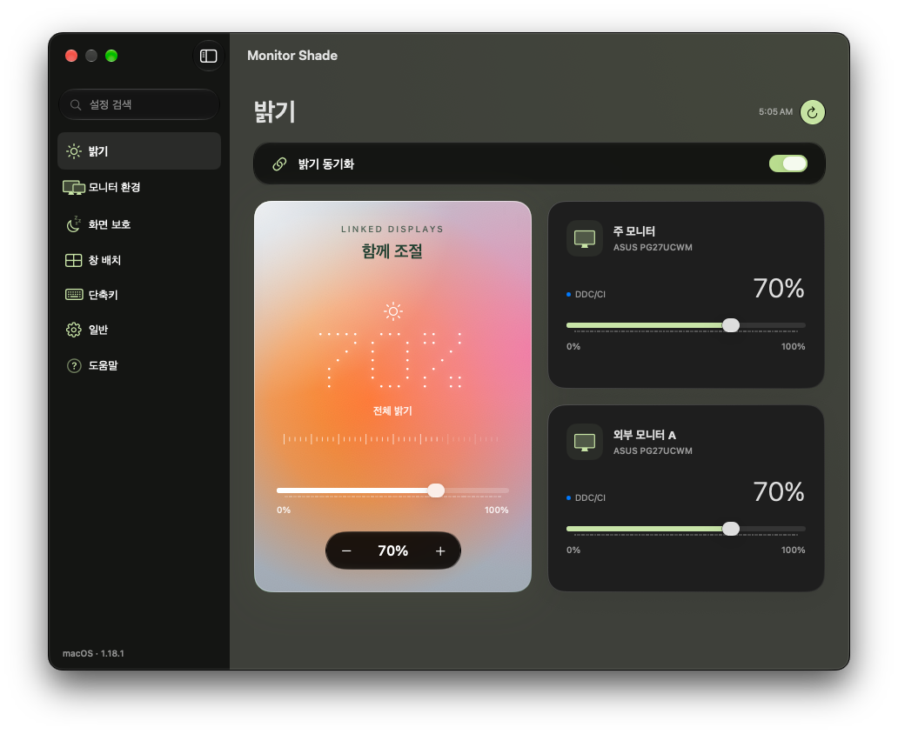
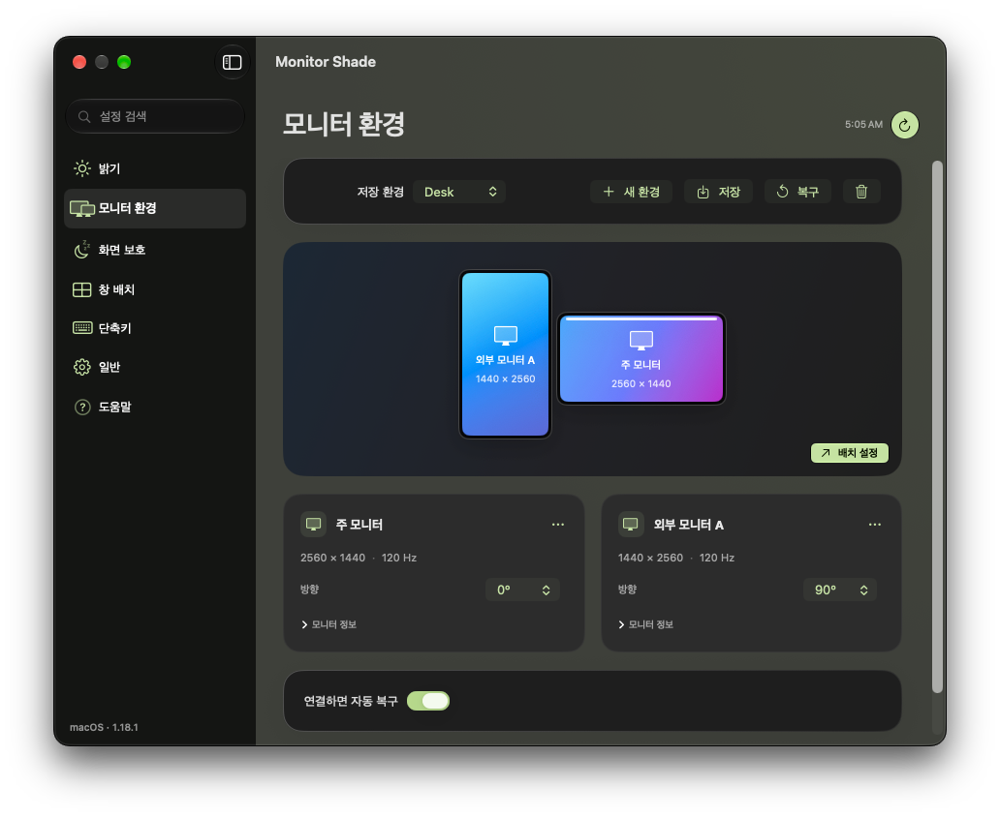
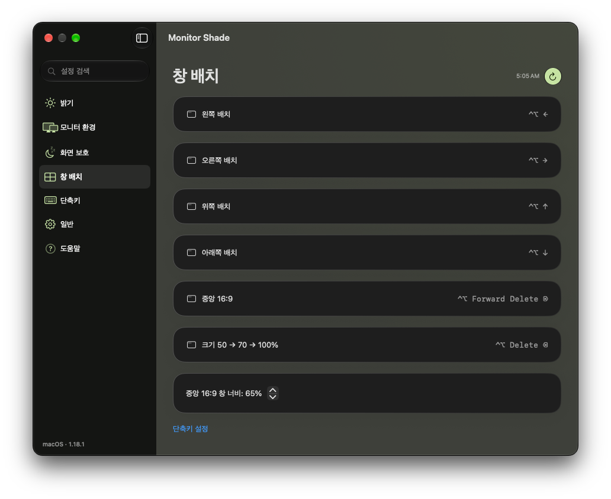
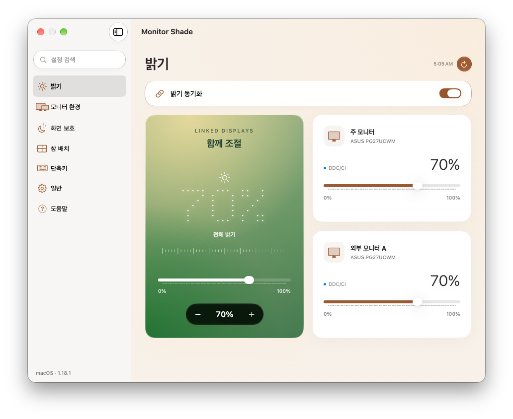

<div align="center">

[Windows](https://github.com/iismn/MonitorShade/tree/window) · **macOS**

# MonitorShade



<sub>macOS 27.0.1 · Native app UI with preview monitors.</sub>

<br><br>

[**Download for macOS**](https://github.com/iismn/MonitorShade/releases/download/mac-v1.18.1/MonitorShade-macOS.zip)

**macOS 14+ · Apple silicon / Intel · Native app**

[Build and source notes](macos/README.md) · [Validation](macos/VALIDATION.md) · [Mac build](https://github.com/iismn/MonitorShade/actions/workflows/macos.yml?query=branch%3Amac) · [Issues](https://github.com/iismn/MonitorShade/issues)

</div>

<br>

## Display Setups



Save display arrangement, primary display, resolution, refresh rate, rotation, mirroring and brightness. Save separate setups for each monitor combination. Reconnect the same monitors to restore a matching setup.

Existing Monitor Shade / Dock Monitor profiles are loaded from `~/Library/Application Support/DockMonitor`. The previous single-profile format is migrated. A profile backup is kept before each write.

<br>

## Brightness

Built-in brightness and external DDC/CI controls. Brightness sync applies the same percentage to supported monitors. Configure brightness keys and step size in **Shortcuts**.

External DDC/CI uses the supplied app's Apple silicon transport. Adapters, HDR modes and Intel hardware can limit external brightness control.

<br>

## OLED Protection

Choose per-display input idle or screen-content changes. Set the delay in seconds and select external displays. The pointer's display stays visible. Manual blanking also wakes on mouse entry.

Screen-content mode needs Screen Recording permission. Wallpaper exclusion compares application windows and ignores the background around them. Frames stay in memory. Built-in and mirrored displays are excluded from OLED protection.

<br>

## Window Layout



| Default shortcut | Action |
| --- | --- |
| **Control + Option + Arrow** | Directional ½ → ⅔ → work area |
| **Control + Option + Forward Delete** | Centered 16:9 → work area |
| **Control + Option + Backspace** | Centered 50% → 70% → work area |
| **Option + F2 / F3** | Brightness down / up |
| **Control + Option + F9 / F10** | Black overlay on external display 1 / 2 |

Edit all bindings in **Shortcuts**. Window control needs Accessibility permission. The work area excludes the Dock and menu bar. Window minimum sizes and native full-screen Spaces can limit placement.

<br>

## Appearance

| Morning | Evening |
| :---: | :---: |
|  |  |

Live desktop blur, time palettes and a glowing dot readout. Native Liquid Glass search and controls on macOS 26 or later, with macOS 27 sidebar refinements. Earlier systems use standard materials. No separate browser runtime.

<br>

<details>
<summary><strong>Install and update</strong></summary>

1. Download and extract `MonitorShade-macOS.zip`.
2. Quit the previous Monitor Shade app.
3. Move **Monitor Shade.app** into **Applications** and open it.
4. Open settings from the display icon in the menu bar.
5. Grant Accessibility permission for window control. Grant Screen Recording only if you use screen-content detection.

The app starts in the menu bar. Change **General → Start hidden** to show settings at launch. Login startup and automatic setup restoration are available in General. macOS may require approval for a login item.

The download is ad-hoc signed and is not Apple notarized. macOS may require first-launch approval in **System Settings → Privacy & Security**. Saved monitor profiles remain in the existing app's storage location. No personal profiles or monitor diagnostics are included in the download.

</details>

<details>
<summary><strong>Build and validation</strong></summary>

Build from the repository root on a Mac with Xcode 26+:

```sh
zsh macos/build.command
```

Output: `dist/Monitor Shade.app`. The build creates arm64 and x86_64 slices, checks the ad-hoc signature and runs hardware-free self-tests. GitHub Actions also renders every settings page with preview monitors and creates a downloadable ZIP.

The supplied native app's profile and hardware code is retained. New regression checks cover window geometry, shortcut validation, settings migration, content-change comparison and the daily card palette. CI cannot verify DDC/CI compatibility, cable reconnection or actual multi-monitor permissions on the user's Mac.

</details>

<br>

---

[Windows branch](https://github.com/iismn/MonitorShade/tree/window) · [macOS source](macos) · [Third-party notices](macos/ThirdPartyLicenses.txt)
